# 📋 PLAN DE TRABAJO: SINCRONIZACIÓN MULTI-DISPOSITIVO Y WEBSOCKETS EN PRODUCCIÓN (AZURE)

> **Proyecto:** NeuroFocus AI – Monitoreo Multimodal de Atención para Estudiantes con TDAH  
> **Entorno:** Producción Cloud (Azure VM `52.185.34.129` • Dominio: `neurofocus.bond`)  
> **Objetivo:** Resolver de forma definitiva la sincronización de video en vivo (cámara web y malla facial MediaPipe) y telemetría biométrica entre computadoras físicas independientes (Estudiante en PC A vs. Psicólogo/Docente en PC B).

---

## 1. 🔍 DIAGNÓSTICO TÉCNICO DE LA PROBLEMÁTICA

### 1.1. Síntomas Reportados en Pruebas de Campo
1. En la **misma PC** (abriendo dos navegadores como Edge y Chrome), la transmisión funciona de forma fluida.
2. Al probar con **dos computadoras físicas distintas en redes diferentes**:
   - El estudiante **Matheo Loza Flores (`EST-2026-496`)** enciende la cámara en su PC, pero no se dibujan las líneas de la malla sobre su rostro.
   - La psicóloga **Jimena** en su PC tiene seleccionado a Matheo, pero el monitor de video permanece en estado:  
     `"Cámara del Estudiante en Espera"` (sin proyectar imagen ni telemetría).

### 1.2. Causas Raíz Identificadas

```mermaid
flowchart LR
    subgraph PC_Estudiante ["PC Estudiante (Matheo)"]
        Cam["Webcam 720p"] --> MP["MediaPipe WASM (Descarga Lenta)"]
        MP -. Retraso .-> WS1["WebSocket wss://.../EST-2026-496"]
    end

    subgraph Azure_Cloud ["Servidor Azure (neurofocus.bond)"]
        NGX["Nginx Proxy Inverso"]
        BE["FastAPI Backend (ConnectionManager)"]
        NGX --> BE
    end

    subgraph PC_Psicologo ["PC Psicóloga (Jimena)"]
        WS2["WebSocket wss://.../EST-2026-496"]
        UI["Monitor de Cámara"]
    end

    WS1 -- "1. Handshake estricto rechazado en red externa" --> NGX
    BE -- "2. Sin oyentes confirmados o frames nulos" --> WS2
    WS2 --> UI
```



1. **Cabeceras de Handshake de Nginx en Redes Externas:**  
   En `nginx.conf`, la directiva `proxy_set_header Connection "Upgrade";` funciona en localhost, pero los navegadores en redes externas envían `Connection: keep-alive, Upgrade`. Sin el mapeo estándar `map $http_upgrade $connection_upgrade`, Nginx rechaza o cierra el túnel WebSocket de larga duración.
2. **Dependencia de MediaPipe para Emitir Fotogramas:**  
   Si en la PC del estudiante el navegador descarga por primera vez los binarios WebAssembly de Google MediaPipe (~10 MB desde CDN) y tarda unos segundos, el cliente React no emitía fotogramas de video crudo hacia el socket. El WebSocket quedaba abierto pero en silencio.
3. **Falta de Trazabilidad en Logs del Backend:**  
   El backend no anunciaba explícitamente en consola cuándo un estudiante y un psicólogo se encontraban en la misma sala, impidiendo saber si ambos estaban conectados al mismo canal en Azure.

---

## 2. 🚀 PLAN DE ACCIÓN POR FASES

### FASE 1: Optimización y Estabilización de Nginx (Proxy Inverso SSL)
* **Archivo:** `frontend/nginx.conf`
* **Acciones:**
  1. Implementar el bloque de mapeo dinámico para actualización de protocolo:
     ```nginx
     map $http_upgrade $connection_upgrade {
         default upgrade;
         '' close;
     }
     ```
  2. Ajustar el bloque `/ws/`:
     ```nginx
     location /ws/ {
         proxy_pass http://backend:8000/ws/;
         proxy_http_version 1.1;
         proxy_set_header Upgrade $http_upgrade;
         proxy_set_header Connection $connection_upgrade;
         proxy_set_header Host $host;
         proxy_set_header X-Real-IP $remote_addr;
         proxy_set_header X-Forwarded-For $proxy_add_x_forwarded_for;
         proxy_read_timeout 86400s;
         proxy_send_timeout 86400s;
         proxy_buffering off;
     }
     ```
  3. Desactivar el buffering en WebSockets (`proxy_buffering off;`) para que los paquetes JPEG en Base64 se transmitan con latencia cero (< 30 ms).

---

### FASE 2: Transmisión Inmediata de Video en Cliente (Frontend React)
* **Archivos:**  
  - `frontend/src/componentes_ui/PrevisualizadorCamara.tsx`  
  - `frontend/src/vistas_estudiante/PortalEstudiante.tsx`
* **Acciones:**
  1. **Transmisión de Video Crudo en Fallback:** En cuanto la cámara física del estudiante enciende, comenzar a emitir fotogramas limpios a 6 FPS hacia el WebSocket sin esperar a MediaPipe.
  2. **Inyección Dinámica de Malla:** En el milisegundo en que MediaPipe termine de descargar y compilar su motor WASM, sobreponer los vectores de mirada 3D y la malla geométrica sobre el video.
  3. **Auto-Reconexión WebSocket Resiliente:** Si la red de la PC remota experimenta una fluctuación o cambio de IP, el socket se reconectará automáticamente cada 1.5 segundos.

---

### FASE 3: Indicador Visual y Selector en Vivo en Dashboard de Autoridades
* **Archivo:** `frontend/src/vistas_autoridades/DashboardAutoridades.tsx`
* **Acciones:**
  1. **Insignia `🟢 EN VIVO` en el Selector de Estudiantes:**  
     Mostrar una insignia verde pulsante en el desplegable al lado de los estudiantes que tienen una sesión de cámara activa en ese instante.
  2. **Banner de Diagnóstico de Red en el Monitor:**  
     Reemplazar el texto genérico *"Cámara en Espera"* por un indicador de estado contextual:
     - 🟡 *«Estableciendo enlace seguro WSS con el servidor...»*
     - 🔵 *«Estudiante conectado al canal. Esperando inicio de cámara en clase...»*
     - 🟢 *«Streaming HD en Vivo conectado (6 FPS - Latencia: 32 ms)»*

---

### FASE 4: Instrumentación de Logs en Backend FastAPI
* **Archivo:** `backend/app/servicios/rutas_websockets.py`
* **Acciones:**
  1. Agregar registros de auditoría en consola para seguimiento en tiempo real:
     ```text
     [WS CONNECT] Cliente conectado a la sala: EST-2026-496 (Total en sala: 1)
     [WS CONNECT] Observador (Jimena) conectado a sala: EST-2026-496 (Total en sala: 2)
     [WS STREAM] Recibiendo frames biométricos de EST-2026-496 (Transmitiendo a 1 oyente)
     ```
  2. Permitir el monitoreo en vivo con un solo comando en Azure:  
     `docker compose logs -f --tail=30 backend`

---

### FASE 5: Protocolo de Pruebas Cruzadas (Validación Final)

| Paso | Dispositivo / Rol | Acción | Resultado Esperado |
| :--- | :--- | :--- | :--- |
| **P1** | **PC 1 (Estudiante)** | Iniciar sesión como `Matheo Loza` (`EST-2026-496`) y encender cámara. | La cámara se ve nítida, la consola confirma el envío de paquetes al socket. |
| **P2** | **Servidor Azure** | Ejecutar `docker compose logs -f backend`. | Muestra `[WS STREAM] Recibiendo frames de EST-2026-496`. |
| **P3** | **PC 2 (Psicóloga)** | Iniciar sesión como `Jimena`, seleccionar a Matheo. | El monitor cambia de amarillo a verde y proyecta el video en vivo de la PC 1. |
| **P4** | **PC 2 (Psicóloga)** | Alternar privacidad: Malla 3D vs. Rostro Real. | En menos de 500 ms, el feed de la PC 1 se anonimiza en la pantalla de la PC 2. |
| **P5** | **Móvil (3er Dispositivo)** | Ingresar como Director (`guillermo`) desde celular. | El directivo puede ver a Matheo simultáneamente sin desconectar a Jimena. |

---

## 3. 🛠️ CRONOGRAMA DE EJECUCIÓN INMEDIATA

- [ ] **Paso 1:** Aplicar parche en `nginx.conf` y `rutas_websockets.py`.
- [ ] **Paso 2:** Aplicar parche en `PrevisualizadorCamara.tsx` y `DashboardAutoridades.tsx`.
- [ ] **Paso 3:** Compilar frontend localmente (`npm run build`) para verificar cero errores de TypeScript.
- [ ] **Paso 4:** Subir cambios a GitHub (`origin/main`).
- [ ] **Paso 5:** Desplegar en Azure (`docker compose up -d --build`).
- [ ] **Paso 6:** Ejecutar la batería de pruebas entre las 2 computadoras físicas.
